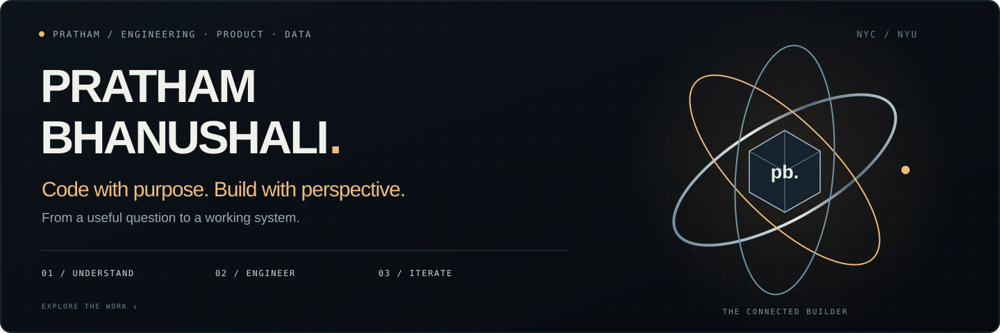
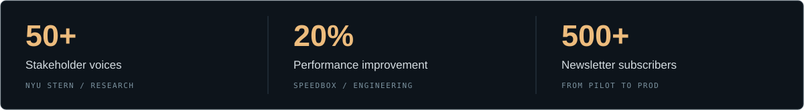

<strong>I connect engineering, analytics, and product thinking to make complex things useful.</strong>

[**Visit Pratham Portfolio →**](https://pratham2888.github.io/pratham-portfolio/) &nbsp; · &nbsp; [**Open the website repository →**](https://github.com/pratham2888/pratham-portfolio)

## The person behind the code

I’m **Pratham**, a New York-based engineer and analyst pursuing an **MS in Management of Technology at NYU**. My work spans software engineering at SpeedBox, data and user research at NYU Stern, and AI/ML research at NYU VIP.

I like the work between disciplines: understanding what someone actually needs, building the system, and checking whether it made a difference.

| Build | Understand | Decide |
| :--- | :--- | :--- |
| React, Redux, REST APIs, Python, Java, C++ | SQL, Pandas, Tableau, D3.js, Qualtrics | User research, product roadmaps, prioritization, OKRs / KPIs |

## Selected experience

| Context | My contribution |
| :--- | :--- |
| **NYU Stern · Data & product** | Research with **50+ stakeholders**, KPI dashboards, and a prioritized improvement roadmap. |
| **SpeedBox · Software engineering** | React and API integrations, workflow improvements, and **20% better performance**. |
| **NYU VIP · AI/ML research** | Success metrics, experiment prioritization, and model validation for AI agents. |
| **Music information retrieval · Research** | CNN/RNN models with MFCC and spectrogram features for genre, tempo, and rhythm. |

## Explore the code

- [**AI Resume Screener**](https://github.com/pratham2888/AI-Resume-Screener) · Python repository
- [**C++ Chatbot**](https://github.com/pratham2888/C-Chatbot) · C++ repository
- [**Task Manager**](https://github.com/pratham2888/Task-Manage-cpp) · C++ repository
- [**Interactive portfolio**](https://github.com/pratham2888/pratham-portfolio) · The source behind my 3D website

[**Explore the full work stories →**](https://pratham2888.github.io/pratham-portfolio/#work)

## From Pilot to Prod

**500+ subscribers. One recurring question: what makes an AI experiment useful in the real world?**

I write about agentic AI, data, and the decisions between an impressive demo and a dependable product.

[**Read the newsletter on LinkedIn →**](https://www.linkedin.com/newsletters/from-pilot-to-prod-7448904844536582144)

---

Understand the problem. Engineer the solution. Learn from the outcome.

